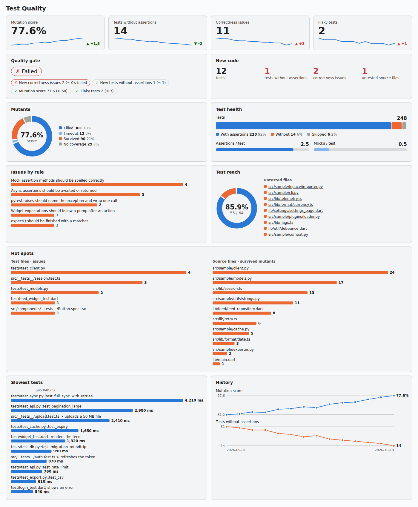

# Test Quality for SonarQube

Finds tests that pass while they check nothing, and measures how good a test suite is, for **Python**,
**JavaScript / TypeScript** and **Flutter / Dart**.

- **38 rules** on test files: an assert that is always true, a mock assertion with a typo, a test that never runs, an
  async assertion nobody awaits, a widget expectation before the frame was pumped.
- **Test quality metrics**: tests, assertions per test, tests without assertions, mocks, mock-heavy and skipped tests,
  and from reports the mutation score, the slowest tests (p95) and flaky tests.
- **A Test Quality page** per project (trends, mutants, test health, test reach, gate conditions, hot spots, slowest
  tests), and every metric is usable in quality gates.

  

The built-in Python and JavaScript analyzers' own test rules (an assert on a tuple, exclusive tests, tests without
assertions) are not repeated. SonarQube has no Dart analyzer; this plugin brings a `dart` language for test files.

## Install

Requires SonarQube Community Build 26.7 or later (tested on 26.10) and Java 21.

1. Download `sonar-test-quality-<version>.jar` from the [releases](https://github.com/snake-in-prod/sonar-test-quality/releases).
2. Copy it to `extensions/plugins/` of the SonarQube server and restart.
3. Profiles. Dart gets "Sonar way" as its default profile with the active rules. For Python, JavaScript and TypeScript the
   bundled analyzers own "Sonar way", and SonarQube lets only one plugin define a built-in profile of a given name, so
   this plugin adds a built-in "Test Quality" profile with its active rules. To keep the analyzer's rules too, extend
   "Sonar way" (*Quality Profiles > Sonar way > Extend*), then on the *Rules* page filter on the repository
   (`testquality-python`, `testquality-js` or `testquality-ts`) and use *Bulk Change > Activate in* your profile.
4. Analyse as usual; test files are found through `sonar.tests` or by name (see Settings).

## Rules

Every rule has a description with an example in SonarQube. Rules not active by default are useful but noisier on
some code bases; activate them in your own profile.

### Python (pytest, unittest)

| Rule | Name | Severity | Active by default |
| --- | --- | --- | --- |
| `MockAssertionTypo` | Mock assertion methods should be spelled correctly | Critical | yes |
| `MockAttributeAsAssertion` | Mock attributes should not be used as assertions | Major | yes |
| `ShadowedTest` | Test names should be unique in a module or class | Critical | yes |
| `UndiscoveredTest` | Tests should be named so the runner collects them | Major | yes |
| `ReturnInsteadOfAssert` | Tests should assert their comparisons, not return them | Major | yes |
| `AssertionInsideRaises` | Assertions should not follow the raising call inside pytest.raises | Major | yes |
| `RaisesTooBroad` | pytest.raises should name the exception and wrap one call | Major | yes |
| `PatchWhereDefined` | mock.patch should target the module that uses the name | Major | yes |
| `MockNeverUsed` | Patched mocks should be used by the test | Minor | no |
| `SleepInTest` | Tests should not sleep | Minor | no |
| `UnseededRandom` | Random values in tests should be seeded | Minor | no |
| `ComparisonWithoutAssert` | Comparisons in tests should be asserted | Major | yes |
| `ExceptSwallowsAssertion` | Assertions should not be caught | Major | yes |
| `ParametrizeMismatch` | pytest.mark.parametrize should match the test parameters | Major | yes |

### JavaScript / TypeScript (Jest, Vitest, Testing Library, Playwright)

| Rule | Name | Severity | Active by default |
| --- | --- | --- | --- |
| `ExpectWithoutMatcher` | expect() should be finished with a matcher | Critical | yes |
| `UnawaitedAsyncAssertion` | Async assertions should be awaited or returned | Critical | yes |
| `AssertionInUnawaitedCallback` | Assertions should not sit in callbacks the test does not wait for | Major | yes |
| `AlwaysTruthyMatcher` | Matchers should be able to fail | Major | yes |
| `ShadowedTest` | Test names should be unique in a describe block | Critical | yes |
| `SnapshotOnlyTest` | Tests should not rely on a snapshot alone | Minor | no |
| `ExpectAssertionsMismatch` | expect.assertions(n) should match the assertions the test can reach | Major | yes |
| `SyncQueryForAsyncUi` | Use findBy queries for UI that renders after an action | Major | yes |
| `WaitForTimeout` | Tests should not wait for a fixed time | Minor | no |
| `MockNeverAsserted` | Mock functions passed in should be asserted on | Minor | no |
| `DoneAndPromise` | Tests should not take done and return a promise | Major | yes |
| `AssertionInLoopNeverRun` | Assertions should not run only inside a loop that can be empty | Minor | no |

### Flutter / Dart (flutter_test, package:test, mockito, mocktail)

| Rule | Name | Severity | Active by default |
| --- | --- | --- | --- |
| `UnawaitedTesterAction` | WidgetTester actions should be awaited | Critical | yes |
| `ExpectWithoutPump` | Widget expectations should follow a pump after an action | Critical | yes |
| `UnawaitedExpectLater` | expectLater should be awaited or returned | Critical | yes |
| `AsyncMatcherNotAwaited` | Async matchers should be awaited before the test ends | Major | yes |
| `VerifyWithoutCall` | verify and when should take a call on a mock | Critical | yes |
| `StubNeverUsed` | Stubs should be used by the test | Minor | no |
| `MockNeverVerified` | Mocks passed in should be verified or stubbed | Minor | no |
| `TrivialMatcher` | Matchers should be able to fail | Major | yes |
| `GoldenOnlyTest` | Widget tests should not rely on a golden file alone | Minor | no |
| `DuplicateTestName` | Test descriptions should be unique in a group | Major | yes |
| `RealDelayInTest` | Widget tests should not wait for real time | Minor | no |
| `SkipWithoutReason` | Skipped tests should say why | Minor | no |

Every rule was run on public projects before release (psf/requests, pallets/flask, encode/httpx, pallets/click,
pytest-dev/pytest-mock, vercel/swr, pmndrs/zustand, testing-library/react-testing-library, felangel/bloc,
rrousselGit/riverpod, flutter/samples): 41 issues, all of them real test defects after the fixes made during the review.

## Metrics

Raw values, prefix `tq_`, saved on test files (code metrics) or on the source files that were mutated (mutation
metrics) and summed up to directories and the project.

| Metric | Source | Meaning |
| --- | --- | --- |
| `tq_tests` | code | test functions and test cases found |
| `tq_assertions` | code | assertions in tests |
| `tq_tests_without_assertion` | code | tests with no assertion they can reach (skipped tests not counted) |
| `tq_assertions_per_test` | code | assertions / tests |
| `tq_mocks` | code | mocks created or patched in tests |
| `tq_mock_heavy_tests` | code | tests with more mocks than assertions |
| `tq_skipped_tests` | code | tests marked skip or xfail |
| `tq_correctness_issues` | rules | issues of the Test Quality rules |
| `tq_mutants`, `tq_mutants_killed`, `tq_mutants_survived`, `tq_mutants_no_coverage`, `tq_mutants_timeout` | mutation report | mutants per source file (killed includes timeouts) |
| `tq_mutation_score` | mutation report | killed / mutants that were run, in % |
| `tq_test_duration_p95` | JUnit XML, Dart JSON | 95th percentile of test time, ms |
| `tq_slowest_tests` | JUnit XML, Dart JSON | JSON list of the 10 slowest tests |
| `tq_flaky_tests` | several reports | tests that both passed and failed across the reports of one analysis |

## Reports

| Setting | Report |
| --- | --- |
| `sonar.testquality.mutation.reportPaths` | mutation-testing-elements JSON: Stryker (`reports/mutation/mutation.json`), or mutmut / cosmic-ray results converted to that format |
| `sonar.testquality.junit.reportPaths` | JUnit XML: `pytest --junitxml=report.xml`, jest-junit, Vitest and Playwright JUnit reporters |
| `sonar.testquality.dart.reportPaths` | `flutter test --machine > test.json` or `dart test --reporter json > test.json` |

Paths are relative to the project base directory or absolute; globs (`**/junit*.xml`) are allowed. Give the reports of
several runs of the same tests (for example reruns in CI) to find flaky tests. A report that cannot be read is logged
and skipped.

## Settings

| Setting | Default | |
| --- | --- | --- |
| `sonar.testquality.python.testPatterns` | `**/test_*.py,**/*_test.py,**/tests/**/*.py,**/conftest.py` | test files under `sonar.sources` |
| `sonar.testquality.js.testPatterns` | `**/*.test.*,**/*.spec.*,**/__tests__/**` | |
| `sonar.testquality.dart.testPatterns` | `**/*_test.dart,**/test/**/*.dart,**/integration_test/**/*.dart` | |
| `sonar.dart.file.suffixes` | `.dart` | set it empty when another plugin already claims `.dart`; two languages cannot share a suffix |
| `sonar.testquality.slowTestMs` | `1000` | slow test threshold on the page |

## Quality gate

Suggested conditions (not installed automatically):

| Condition | On new code | On overall code |
| --- | --- | --- |
| Test correctness issues (`tq_correctness_issues`) | 0 | |
| Tests without assertion (`tq_tests_without_assertion`) | 0 | |
| Mutation score (`tq_mutation_score`) | | at least your baseline, e.g. 60 % |
| Flaky tests (`tq_flaky_tests`) | 0 | |

## Without SonarQube

`java -cp target/classes:<gson jar> io.github.snakeinprod.testquality.cli.Scan <dir>` runs every rule on a directory and
prints the issues, a count per rule and the number of tests found.

## Build

`./mvnw verify` (Java 21). The design is in [docs/DESIGN.md](docs/DESIGN.md).

## License

Apache-2.0
